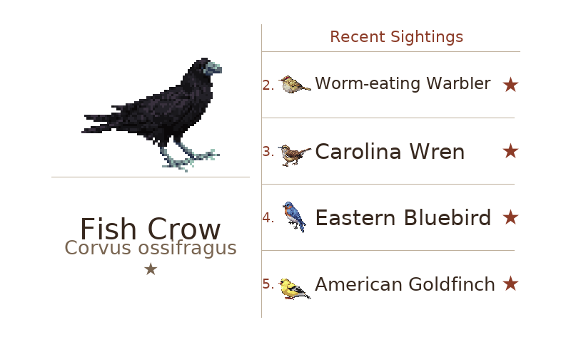

# picolay

A tiny flexbox-style layout engine that renders straight to a [Pillow](https://python-pillow.org/) image. It was built for e-ink picture frames, where you want CSS-like layout without a browser.



*The field-guide layout from an 800×480 bird-sighting e-ink frame, rendered with picolay.*

The only dependency is Pillow. DejaVu Sans is bundled as the default font.

## Install

```bash
pip install "picolay @ git+https://github.com/delps1001/picolay@v0.2.1"
```

## Example

```python
from picolay import Box, Img, Style, Text, render

card = Box(
    style=Style(width=200, height=300, flex_direction="column", background=(255, 255, 255)),
    children=[
        Img(src="sprite.png", style=Style(flex_grow=0.7, object_fit="contain", image_rendering="pixelated")),
        Box(
            style=Style(flex_grow=0.3, align_items="center", justify_content="center"),
            children=[Text("House Finch", style=Style(font_size=14, text_align="center"))],
        ),
    ],
)

image = render(card, 200, 300)          # white background
overlay = render(card, 200, 300, background=None)  # transparent RGBA
```

## Building blocks

- `Box(style, children)`: a flex container. By default it fills the space it's given; `width="fit"` / `height="fit"` shrink-wraps it to its children instead.
- `Text(content, style=...)`: a single line of text, or wrapped lines with `wrap=True`.
- `Img(src, style=...)`: a PIL image, or a path to one.
- `render(node, width, height, background=..., antialias=True)`: draws the tree. Pass `antialias=False` for hard-edged text on 1-bit displays.
- `compute_layout(node, width, height, antialias=True)`: the layout tree without rendering, handy for tests. Pass the same `antialias` you render with, since hard-edged text measures slightly differently.

### Style

| Group | Properties |
|---|---|
| Size | `width`, `height` (pixels, a float between 0 and 1.0 for a fraction of the parent, or `"fit"` on a Box), `min_*`, `max_*` |
| Box model | `padding`, `margin`, `border`, `background`, `overflow` |
| Flex | `flex_direction`, `justify_content`, `align_items` (`start`, `center`, `end`, `stretch`, or `baseline` to line up text in a row), `gap`, `flex_grow` |
| Images | `object_fit` (`contain`, `cover`, `fill`, or `none` to place a pre-processed image at its natural size), `image_rendering` |
| Text | `font_size`, `font_path`, `font_color`, `text_align`, `wrap`, `line_spacing`, `font_shrink`, `min_font_size` |

`font_shrink` steps the font down until the text fits: the width for a single line, and both width and height for wrapped text. It never goes below `min_font_size`, and it never truncates.

## Example: wrapped, baseline-aligned text

```python
from picolay import Box, Style, Text, render

card = Box(
    style=Style(width=400, height=240, padding=16, flex_direction="column", gap=8),
    children=[
        Box(
            style=Style(height="fit", align_items="baseline", gap=10),
            children=[
                Text("#006", style=Style(font_size=24, font_color=(100, 100, 100))),
                Text("Charizard", style=Style(font_size=40, font_path="/path/to/DejaVuSans-Bold.ttf")),
            ],
        ),
        Text(
            "Spits fire that is hot enough to melt boulders. Known to cause forest fires unintentionally.",
            style=Style(wrap=True, font_shrink=True, font_size=22, min_font_size=10, flex_grow=1),
        ),
    ],
)
image = render(card, 400, 240)
```

## Development

```bash
uv run --extra dev pytest
```

## License

picolay is released into the public domain under [the Unlicense](LICENSE). Do whatever you like with it.

The bundled DejaVu Sans font (`src/picolay/DejaVuSans.ttf`) keeps its own permissive [DejaVu Fonts license](https://dejavu-fonts.github.io/License.html).
